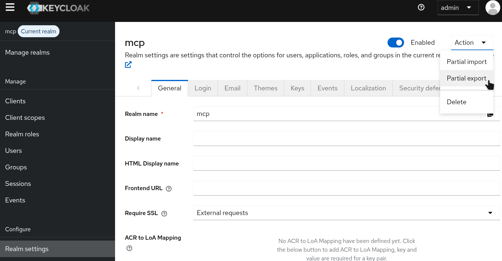
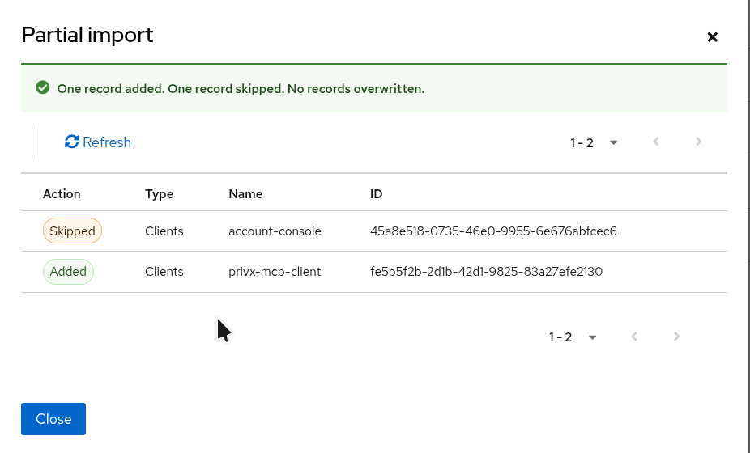
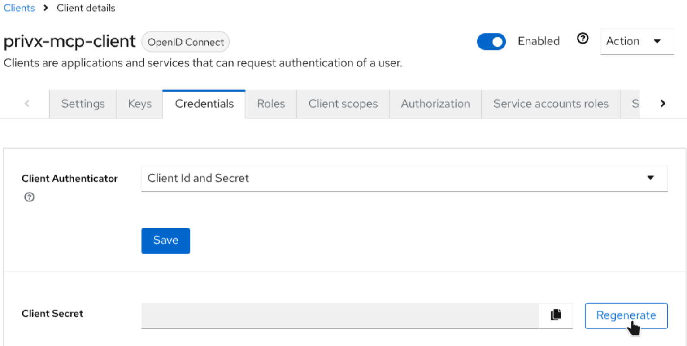

# Local Docker demo

Start a local **PrivX MCP server + Keycloak** stack. You need an existing PrivX test/dev instance.

> **Important**
>
> The demo instruction are made with the assumption that you perform them on your `localhost`. If you connect to a remote host, you may encounter issues with authentication and security in general.
>
> **About Keycloak authentication**
>
> Ideally you would use your organisation's identity provider (IdP), but depending on your role, getting access to it may not be easy, and some IdPs are complicated to integrate. For evaluating the MCP server, we recommend Keycloak because it is relatively easy to set up and lets you create users as needed.
>
> This document only covers Keycloak briefly. For a more comprehensive guide, see [Keycloak](../../../docs/reference/oidc/keycloak.md).

## Navigation

- **Back to flow**: [Guide](../../../docs/README.md#guide)
- **Manual provider setup**: [Keycloak](../../../docs/reference/oidc/keycloak.md)
- **Client connection**: [MCP client configuration](../../../docs/reference/clients/CLIENTS.md)

These instructions assume everything runs on **localhost**. To access Keycloak from a remote address, it must serve HTTPS (which requires a TLS certificate) or sit behind an HTTPS proxy such as NGINX. Remote setups are out of scope for this document.

## Before you begin

Clone this repository and change to its directory, for example:

```bash
mkdir -p ~/src && cd ~/src
git clone https://github.com/SSHcom/privx-mcp.git
cd privx-mcp
```

> **Note**
>
> Run every command from the **repository root** (e.g. `~/src/privx-mcp`) unless the instructions say otherwise.

## 1. Create `.env`

Copy the demo environment file to the repository root:

```bash
cp deploy/docker/demo/.demo-env .env
```

Then fill in the missing values in `.env` by replacing each `<...>` placeholder, including the angle brackets. The sections below explain the values that need some preparation.

### `PRIVX_RSA_KEY_FILE`

After the user signs in through OAuth, the MCP server maps the Keycloak user to a PrivX user through an External Token Provider. From PrivX's point of view, every API call made by an MCP tool is made by that PrivX user. The trust between the MCP server and PrivX is secured by an RSA key pair: the MCP server signs tokens with the private key, and the public key is added to the token provider configuration in PrivX (see [step 7](#7-privx-external-token-provider)).

Create the key pair:

```bash
mkdir -p .pem
openssl genrsa -out .pem/private-key.pem 2048
openssl rsa -in .pem/private-key.pem -pubout -out .pem/public-key.pem
```

Set `PRIVX_RSA_KEY_FILE` to the absolute path of `.pem/private-key.pem`. The file must exist before you start Docker Compose.

### `PRIVX_API_*`

These are the standard settings for a PrivX API client. The MCP server uses this connection for the few API calls that are not made on behalf of a specific user. Create an API client in PrivX and copy the client ID and secrets from there. The role assigned to the API client must have the `users-view` and `roles-view` permissions.

## 2. Start Keycloak

Start only Keycloak first. The MCP server requires the `mcp` realm to exist, so you must create it before starting the server.

```bash
docker compose up --build keycloak
```

| Service  | URL                                            | Notes                                 |
| -------- | ---------------------------------------------- | ------------------------------------- |
| Keycloak | [http://localhost:8080](http://localhost:8080) | Admin user `admin` / password `admin` |

If something goes wrong, check the logs: `docker logs keycloak`.

## 3. Create the `mcp` realm and import the client

1. Open [http://localhost:8080](http://localhost:8080) and sign in as `admin`.
2. Create a new realm named `mcp`.
3. Switch to the new realm (refresh the page if it is not listed).
4. Open **Realm settings**. From **Action**, choose **Partial import**:

   
5. Click **Browse...** and select `deploy/docker/demo/realm-export.json`.

   Check **Clients**, choose **Skip** for _"If a resource already exists"_, then click **Import**:

     
6. Confirm that `privx-mcp-client` was added:

   

## 4. Start all containers

Now that the `mcp` realm exists, start the full stack:

```bash
docker compose up --build
```

| Service    | URL                                            |
| ---------- | ---------------------------------------------- |
| Keycloak   | [http://localhost:8080](http://localhost:8080) |
| MCP server | [http://localhost:8181](http://localhost:8181) |

If something goes wrong, check the logs: `docker logs privx-mcp-server` or `docker logs keycloak`.

## 5. Client secret

In Keycloak, open **Clients** → `privx-mcp-client` → **Credentials** and click **Regenerate** to create the secret.



This is the client secret that an AI client asks for when you set up the MCP server. You can come back to this page and copy it whenever you need it; there is no need to copy it now.

## 6. Create a Keycloak user that matches a PrivX user

1. Open **Users** and create a user whose **Username** matches an existing PrivX user. Make sure the PrivX user is in the **Local users** directory.
2. Turn **Email verified** on.
3. On the **Credentials** tab, set a password and turn **Temporary** off.

## 7. PrivX: External Token Provider

The OAuth login (Keycloak) yields a username. The MCP server uses that name to find a matching PrivX user. This demo looks in the **Local users** user directory; the same flow works with Entra ID, AD, or another directory.

To open a PrivX API connection _as that user_, PrivX must trust a short-lived token minted by the MCP server. Register that trust as described in [External token provider](../../../docs/reference/server/privx-token-provider.md).

In PrivX: **Administration** → **Deployment** → **External Token Authentication** → **Add provider**.

| Field                          | Value                                                |
| ------------------------------ | ---------------------------------------------------- |
| Name                           | `mcp-provider`                                       |
| Users Directory                | Local users                                          |
| Subject Type                   | plain                                                |
| Public key method              | Use token provider key                               |
| Key ID                         | `privx-aws-mcp-demo`                                 |
| Public key                     | The full contents of `.pem/public-key.pem`           |
| Issuer                         | `privx-mcp`                                          |
| Service Name in Audience Claim | `privx-mcp-client` (the name of the Keycloak client) |

> **Note**
>
> These values match what is already set in `.env` (`PRIVX_RSA_KEY_ID`, `PRIVX_TOKEN_ISSUER`, `PRIVX_SUBJECT_FORMAT` and `PRIVX_AUDIENCE`). If you change one side, change the other as well.

## 8. Connect an AI client

You need:

- The MCP server URL: `http://localhost:8181/mcp`
- The Keycloak client ID: `privx-mcp-client`
- The client secret from Keycloak (**Clients** → `privx-mcp-client` → **Credentials** → **Client secret**, see [step 5](#5-client-secret))

There are two ways to connect: let the MCP client handle OAuth itself, or run the PrivX MCP proxy between the client and the server. See [MCP client configuration](../../../docs/reference/clients/CLIENTS.md) for details about specific clients.

### Option A: OAuth directly in the client

Prefer this option if your client supports it.

The example below works with Cursor. Many other clients use the same or a similar configuration.

```json
{
  "mcpServers": {
    "mcp-demo": {
      "url": "http://localhost:8181/mcp",
      "auth": {
        "CLIENT_ID": "privx-mcp-client",
        "CLIENT_SECRET": "<client secret>"
      }
    }
  }
}
```

### Option B: PrivX MCP proxy

Use this option if your client does not support OAuth, or if OAuth does not work properly with it.

The proxy takes over OAuth authentication from the MCP client. The MCP client starts the proxy as a local STDIO server, and the proxy forwards tool calls to the MCP server.

#### Build the proxy

1. Install Go 1.26 or later.
2. From the repository root, run:
   ```bash
     mkdir -p bin
     go build -o bin/privx-mcp-proxy ./cmd/privx-mcp-proxy
   ```
3. The binary is now available as `<repo-root>/bin/privx-mcp-proxy`.

#### Configure the proxy

Create a proxy config file at `<repo-root>/privx-mcp-proxy.toml`:

```toml
mcp_url = "http://localhost:8181/mcp"
allow_http = true
log_level = "info"

[callback]
# The resulting redirect URI, http://localhost:28828/oauth/callback,
# must be allowed in the Keycloak client (the imported client already allows it).
host = "localhost"
port = 28828
path = "/oauth/callback"
auth_timeout_seconds = 60

[client]
client_id = "privx-mcp-client"
client_secret = "<client secret>"
token_endpoint_auth_method = "client_secret_post"
scopes = []
```

#### Configure the MCP client

In your MCP client config, add an entry that starts the proxy. Replace `<repo-root>` with the absolute path to the repository.

```json
{
  "mcpServers": {
    "privx-proxy": {
      "command": "<repo-root>/bin/privx-mcp-proxy",
      "args": ["<repo-root>/privx-mcp-proxy.toml"]
    }
  }
}
```
