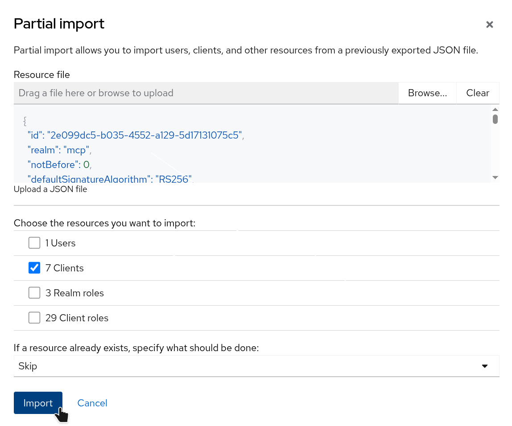

# Local Docker demo

Start a local **Keycloak** + **PrivX MCP server** stack. You need an existing PrivX test/dev instance.

This document is the **demo import shortcut** path. For manual Keycloak setup in production-style environments, use [Keycloak](../../../docs/reference/oidc/keycloak.md).

## Navigation

- **Back to flow**: [Guide](../../../docs/README.md#guide)
- **Manual provider setup**: [Keycloak](../../../docs/reference/oidc/keycloak.md)
- **Client connection**: [MCP client configuration](../../../docs/reference/clients/CLIENTS.md)

Run every command from the **repository root**.

These instructions assume everything runs on **localhost**. To access Keycloak from a remote address it must serve HTTPS (requires an SSL certificate) or sit behind an HTTPS proxy such as NGINX. Remote setups are out of scope for this document.

## Before you begin

The demo requires you to clone this repository and change to its directory:

Example:

```bash
cd ~/src # Create if needed
git clone https://github.com/SSHcom/privx-mcp.git
cd privx-mcp
```

> Note
>
> If the current directory is not mentioned in the instructions, assume it's in the repository root (e.g. `~/src/privx-mcp`).

## 1. Create `.env`

```bash
cp deploy/docker/demo/.demo-env .env
```

Fill in the missing values in `.env` (replace the `<...>` placeholders, including the brackets).

If you do not already have an RSA key pair, create one.

```bash
mkdir -p .pem
openssl genrsa -out .pem/private-key.pem 2048
openssl rsa -in .pem/private-key.pem -pubout -out .pem/public-key.pem
```

Point `PRIVX_RSA_KEY_FILE` at the absolute path of `private-key.pem`. The file must exist before you start Compose.

## 2. Start Keycloak

Start only Keycloak first. The MCP server requires the `mcp` realm to exist, so it must be created before the server starts.

```bash
docker compose up --build keycloak
```

| Service  | URL                                            | Notes                                 |
| -------- | ---------------------------------------------- | ------------------------------------- |
| Keycloak | [http://localhost:8080](http://localhost:8080) | Admin user `admin` / password `admin` |

You can check the logs, to see if there are issues: `docker logs privx-mcp-server | keycloak`

## 3. Create the `mcp` realm and import the client

1. Open [http://localhost:8080](http://localhost:8080) and sign in as `admin`.
2. Create a new realm named `mcp`.
3. Switch to the new realm (refresh if there is not link).
4. Open **Realm settings**. From **Action**, choose **Partial import**:

   

5. Click **Browse...** and select `deploy/docker/demo/realm-export.json`.

   Check **Clients**, choose **Skip** for _"If a resource already exists"_, then **Import**:
   

6. Confirm that `privx-mcp-client` was added:

   

## 4. Start all containers

Now that the `mcp` realm exists, start the full stack:

```bash
docker compose up --build
```

| Service    | URL                                            |
| ---------- | ---------------------------------------------- |
| Keycloak   | [http://localhost:8080](http://localhost:8080) |
| MCP server | [http://localhost:8181](http://localhost:8181) |

Check the logs if there are issues: `docker logs privx-mcp-server` or `docker logs keycloak`.

## 5. Client secret

In Keycloak open **Clients** → `privx-mcp-client` → **Credentials** and click **Regenerate** to create the secret.


When an AI client asks for a client secret while setting up the MCP server, this is it. You can copy it from this page whenever you need it; there is no need to copy it before the client asks.

## 6. Create a Keycloak user that matches a PrivX user

1. Open **Users** and create a user whose **Username** matches an existing PrivX user. Make sure the PrivX user is in the "Local users" directory.
2. Turn **Email verified** on.
3. On the **Credentials** tab, set a password and turn **Temporary** off.

## 7. PrivX: External Token Provider

The OAuth login (Keycloak) yields a username. The MCP server uses that name to find a matching PrivX user. This demo looks in the **Local users** user directory; the same flow works with Entra ID, AD, or another directory.

To open a PrivX API connection _as that user_, PrivX must trust a short-lived token minted by the MCP server. Register that trust as described in [External token provider](../../../docs/reference/server/privx-token-provider.md).

In PrivX: **Administration** → **Deployment** → **External Token Authentication** → **Add provider**.

| Field                          | Value                                                |
| ------------------------------ | ---------------------------------------------------- |
| Name                           | mcp-provider                                         |
| Users Directory                | Local users                                          |
| Subject Type                   | plain                                                |
| Public key method              | Use token provider key                               |
| Key ID                         | privx-aws-mcp-demo                                   |
| Puiblic key                    | <The full contents of `.pem/public-key.pem`>         |
| Issuer                         | privx-mcp                                            |
| Service Name in Audience Claim | privx-mcp-client `<the name of the Keycloak client>` |

> Note
>
> The Field values match what is already set in `.env`:

## 8. Connect an AI client

What you need:

- The URL of the MCP server: `http://localhost:8181/mcp`
- The name of the Keycloak client: `privx-mcp-client`
- The Client secret from Keycloak (`Clients` -> `privx-mcp-client` -> `Credendials` -> `Client secret`)

### Configure your MCP client

See [MCP client configuration](../../../docs/reference/clients/CLIENTS.md) for details about specific clients.

#### OAuth – directly in the client

If supported prefer this option.

Here is an example that works with Cursor. Many clients use an identical or similar (with small variations) configuration.

```
{
  "mcpServers": {
    "mcp-demo": {
      "url": "http://localhost:8181/mcp",
      "auth": {
        "CLIENT_ID": "privx-mcp-client",
        "CLIENT_SECRET": "<some secret>"
      }
    }
  }
}
```

#### PrivX MCP proxy

Use this option if OAuth is not supported or working properly.

This moves OAuth authentication away from the MCP client to a generic proxy client. The MCP client will connect to the proxy using the STDIO method.

To use the proxy, it has to be build

- Install Go version 1.26
- In the MCP repository root, run...
  ```bash
  mkdir -p bin
  go build -o bin/privx-mcp-proxy ./cmd/privx-mcp-proxy
  ```
- The binary should now be available as `<repo-root>/bin/privx-mcp-proxy`

Now create a proxy config file at `<repo-root>/privx-mcp-proxy.toml`

```toml
mcp_url = "http://localhost:8181/mcp"
allow_http = true
log_level = "info"

[callback]
host = "localhost"
port = 28828             # Requires "http://localhost:<port>/oauth/callback"
path = "/oauth/callback" # redirect URI in Keycloak
auth_timeout_seconds = 60

[client]
client_id = "privx-mcp-client"
client_secret = "TYvB8dydUUy3waDvv9HuGhDdPTqLOiOD"
token_endpoint_auth_method = "client_secret_post"
scopes = []
```

In your MCP client config, create an entry pointing to the proxy.

```
{
  "mcpServers": {
    "privx-proxy": {
      "command": "/<repo-root>/bin/privx-mcp-proxy",
      "args": [
        "/<repo-root>/privx-mcp-proxy.toml"
      ]
    }
  }
}
```
