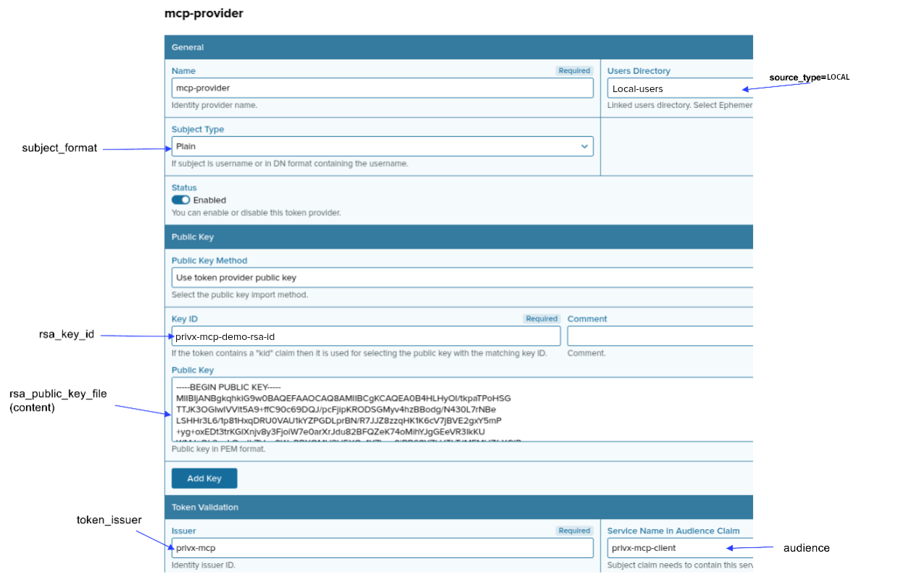

# Configure machine-to-machine access

Use machine-to-machine access when a client cannot run the browser-based OAuth flow. There are two modes:

| Mode      | Client sends                                         | Identity comes from                          |
| --------- | ---------------------------------------------------- | -------------------------------------------- |
| `m2m`     | `Authorization: Bearer <secret>`                     | The service secret, mapped to one PrivX user |
| `m2m-jwt` | `X-API-KEY: <key>` and `Authorization: Bearer <jwt>` | A claim in the JWT, mapped to one PrivX user |

**Pick** `m2m-jwt` when another component, such as a gateway or a backend service, obtains the JWT through OAuth or any other flow and hands it to the MCP client, so the client never runs a login itself.

**Pick** `m2m` when a simpler approach is acceptable, for example when obtaining a JWT does not fit the client's flow and each machine can hold its own long-lived secret.

> **Note**
>
> The server runs one authentication mode at a time (`oauth`, `m2m`, or `m2m-jwt`). Only authentication differs between them; everything after it works the same.
>
> **Never use machine-to-machine authentication for end-user scenarios.** Anyone who gets hold of a secret or API key can act as a mapped PrivX user. See [Security concerns](#security-concerns).

## Prepare PrivX

Both modes use the basic settings described in [Configure the server](../03-configure.md).

In PrivX, two things must be in place: an external token provider that trusts the server's signing key, and an API client that can look up users and roles.

### Register an External Token Provider

The server signs a short-lived JWT for each tool call and exchanges it for a PrivX access token. PrivX accepts that JWT only after the server's public key is registered as an external token provider.

1. Generate a key pair as described in [PrivX configuration](../../reference/server/privx.md#1-generate-an-rsa-key-pair). Save the files on the host where the MCP server runs, in a directory the server process can read. Point `[privx_auth].rsa_key_file` at the private key.
2. In the PrivX UI, open **Administration → Deployment → External Token Authentication**, click **Add provider**, and paste in the public key.
3. Fill in the remaining provider fields so that they match the configuration parameters below.

The screenshot below labels each provider field with its matching configuration parameter.



| PrivX field                    | Configuration parameter            | Description                                                                                                                                                                                                                              |
| ------------------------------ | ---------------------------------- | ---------------------------------------------------------------------------------------------------------------------------------------------------------------------------------------------------------------------------------------- |
| Subject Type                   | `[privx_auth].subject_format`      | Format of the subject claim. Normally `plain`.                                                                                                                                                                                           |
| Key ID                         | `[privx_auth].rsa_key_id`          | JWT key ID.                                                                                                                                                                                                                              |
| Public Key                     | `[privx_auth].rsa_public_key_file` | Optional path to the RSA public key file. Paste the content of this file into the provider. When set, the server checks at startup that it matches `rsa_key_file`.                                                                       |
| Issuer                         | `[privx_auth].token_issuer`        | JWT issuer ID.                                                                                                                                                                                                                           |
| Service Name in Audience Claim | `[privx_auth].audience`            | JWT audience.                                                                                                                                                                                                                            |
| Users Directory                | `[permissions].source_type`        | Directory type that mapped users must belong to. Use the underlying type of the directory selected in **Users Directory**, for example `LOCAL` for local users, `MICROSOFTGRAPH` for Entra ID users, or `AD` for Active Directory users. |

Local PrivX users are recommended for machine-to-machine access.

### Create a PrivX API client

The server uses a separate API client to resolve the PrivX user and that user's roles.

1. Open **Administration → Deployment → Integrate with PrivX Using API Clients** and click **Add API Client**, or reuse an existing client.
2. Attach a role that includes the `roles-view` and `users-view` permissions.
3. Copy the values from the client to the configuration parameters below.

| Configuration parameter                | Description                                                                                                                                                                        |
| -------------------------------------- | ---------------------------------------------------------------------------------------------------------------------------------------------------------------------------------- |
| `[privx_auth].api_oauth_client_id`     | OAuth client ID. Typically `privx-external`.                                                                                                                                       |
| `[privx_auth].api_oauth_client_secret` | OAuth client secret.                                                                                                                                                               |
| `[privx_auth].api_client_id`           | PrivX API client ID.                                                                                                                                                               |
| `[privx_auth].api_client_secret`       | PrivX API client secret.                                                                                                                                                           |
| `[privx_auth].ca_cert`                 | Optional trust anchor, available on the **API Clients** page. Needed when the PrivX TLS certificate is self-signed or signed by a private CA. PEM content or a path to a PEM file. |

## Generate secrets

`m2m` needs one service secret per mapping, each at least 32 characters. `m2m-jwt` needs one API key of at least 12 characters; 32 or more is recommended. If your organization does not already issue these, generate them with either command:

- `openssl rand -hex 32` (64 hex characters)
- `tr -dc A-Za-z0-9 </dev/urandom | head -c 64; echo` (64 alphanumeric characters)

In production, prefer environment variables so the values stay out of the config file. After loading, the server keeps only the SHA-256 hash of each secret or key, and neither the values nor the request headers are logged.

## `m2m` mode

### Map secrets to users

Each service secret maps to one PrivX user.

- `[server].m2m_identity_mapper` holds all mappings in one string.
  - Entries are separated by `|`.
  - Each entry is `<privx username> <secret>`, with one space between the two.
  - Example: `m2m_identity_mapper = "privx-user-1 <secret>|privx-user-2 <secret>"`
- A username may appear more than once, which is how you rotate secrets: both work until you remove the old entry and restart. A secret may appear only once.
- Usernames and secrets cannot contain a space or `|`.

Full configuration examples for this mode:

- [m2m.toml](examples/m2m.toml)
- [m2m.env](examples/m2m.env) – if you use environment variables

### Configure the client

The client sends `Authorization: Bearer <secret>` to `/mcp`. The secret must be one of the values in `[server].m2m_identity_mapper`. Client configuration varies between agent solutions.

Example:

```json
{
  "mcpServers": {
    "privx-mcp-m2m": {
      "url": "https://mcp.example.net:8181/mcp",
      "headers": {
        "Authorization": "Bearer replace-with-secret"
      }
    }
  }
}
```

### How it works

- The server hashes the presented secret and compares it with the stored hash of each mapping. If no mapping matches, the server responds with `401`.
- The username in the matching entry is the PrivX user, and tool calls run with that user's permissions.
- A secret stays valid until its entry is removed and the server is restarted.

## `m2m-jwt` mode

### Map claims to users

The client presents a shared API key, and a claim in its JWT maps to one PrivX user.

- `[server].m2m_jwt_key` holds the shared key (at least 12 characters).
- `[server].m2m_jwt_issuer` is optional. When set, the token's `iss` must equal it.
- `[server].m2m_jwt_identity_mapper` holds all mappings in one string.
  - Entries are separated by `|`.
  - Each entry is `<claim> <value> <privx username>`, separated by single spaces. `<claim>` is either `preferred_username` or `email`.
  - Example: `m2m_jwt_identity_mapper = "preferred_username user-1 privx-user-1|email user-2@example.com privx-user-2"`
- A username may appear more than once. A claim and value pair may appear only once.
- None of the three fields may contain a space or `|`.

Full configuration examples for this mode:

- [m2m-jwt.toml](examples/m2m-jwt.toml)
- [m2m-jwt.env](examples/m2m-jwt.env) – if you use environment variables

### Configure the client

The client sends `X-API-KEY: <key>` and `Authorization: Bearer <jwt>` to `/mcp`. `X-API-KEY` must equal `[server].m2m_jwt_key`. The JWT comes from another component that passes it to the client. Client co12nfiguration varies between agent solutions.

Example:

```json
{
  "mcpServers": {
    "privx-mcp-m2m-jwt": {
      "url": "https://mcp.example.net:8181/mcp",
      "headers": {
        "X-API-KEY": "replace-with-api-key",
        "Authorization": "Bearer <jwt>"
      }
    }
  }
}
```

### How it works

- The server hashes the presented key and compares it with the stored hash. A missing or wrong key gets a `401` response.
- The JWT is parsed without a signature check. A missing or expired `exp` gets a `401` response, as does an `iss` that does not exactly match `[server].m2m_jwt_issuer` when that is set.
- The token's claim must match exactly one mapping; otherwise the server responds with `401`. The username in the matching entry is the PrivX user, and tool calls run with that user's permissions.
- The key stays valid until it is replaced and the server is restarted. To remove one user's access, delete their mapping entries and restart.
- Because the signature is not checked, anyone with the API key can present a JWT with any mapped claim and act as that user.

## Start the server

When the configuration is ready, run the binary:

- With a configuration file: `privx-mcp-server --config /path/to/config.toml`
- With environment variables only: `privx-mcp-server`

See [MCP server configuration](../../reference/server/SERVER.md) for the full configuration reference.

## Security concerns

In both modes, the real security boundary is the shared secret material: the bearer secret in `m2m` and the `X-API-KEY` in `m2m-jwt`.

In `m2m-jwt`, the JWT is not signature-verified. The `exp` and optional `iss` checks reject malformed or stale tokens, but they are not cryptographic proof of identity and do not stop someone who has the API key from forging a token.

The identity mappings limit the blast radius: a caller can only become a PrivX user that is explicitly mapped, and unmapped identities are rejected.

Static header credentials (bearer tokens, API keys, or both) between trusted components are a common pattern in MCP deployments. Some deployments run agents and MCP servers in shielded networks with no route to an external signing authority, so `m2m-jwt` does not depend on one.

Treat machine-to-machine credentials as privileged secrets and keep them out of end-user workflows. The operator is responsible for re-issuing secrets and API keys, restarting the server to apply new values, and keeping the JWT issuing process secure.

## Reference

- [MCP server configuration](../../reference/server/SERVER.md)
- [PrivX configuration](../../reference/server/privx.md)
- [TLS (HTTPS)](../../reference/server/tls.md)
- [Security considerations](../../reference/security/security.md)

## Navigation

**Previous**: [Configure the server](../03-configure.md)

**Next**: [Security and user operations](../05-security-and-usage.md)

---

**Overview**: [Documents Hub](../../README.md)
