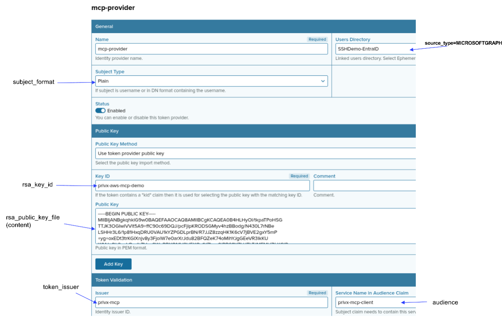

# Run the MCP server in M2M-JWT mode

This quick start covers how to configure and run the MCP server in M2M (machine-to-machine) mode using a JWT.

This mode does not initiate an OAuth flow. The JWT must be acquired beforehand through a trusted method.

Do not use this mode for end users, because it can introduce security risks.

## Create the server binary

Builds for various systems are supported. The build commands are set up in `Taskfile.yml`, which requires the [Task](https://taskfile.dev/) task runner. Run `cat Taskfile.yml` to see the commands themselves.

- Install the [Task](https://taskfile.dev/) task runner.
- Run `task list` to see all task targets.
- On most Linux platforms, run `task build:linux:amd64`.
- When the build host and the target host are the same, run `task build`.
- Binaries are written to `bin/`.

## Run the binary

You can start the server in two ways. The commands below use `privx-mcp-server`; substitute the binary name from your build.

1. Configuration file: `<path>/privx-mcp-server --config <path>/config.toml`
2. Environment variables: `KEY=value KEY=value <path>/privx-mcp-server`

## Server configuration

- The [Server](../server/SERVER.md) document describes each section of the configuration file and the matching environment variable names.
- Environment variable names follow `<SECTION>_<KEY>` in uppercase.
- You can combine the configuration file with environment variables. Environment variables take precedence.
- See the [example configuration](#example-configuration) below.

### Enable HTTPS

Skip this step if you run the MCP server behind a proxy.

- Point `tls_cert_file` and `tls_key_file` to the certificate and key files.
- See the [TLS](../server/tls.md) document for how to create a self-signed TLS certificate.

### Create an External Token Provider in PrivX

Access to PrivX is granted through a user claim and secured with a key pair.

- Go to `Administration` → `Deployment` → `External Token Authentication`.
- Click `Add provider`.

The screenshot below is a provider example. It shows the matching MCP configuration parameters.

Claims must match users in a specific directory. In the screenshot, Entra ID users map to a source type of `MICROSOFTGRAPH`. For M2M mode, use a local PrivX account. For local accounts, `source_type` must be `LOCAL`.

See [PrivX configuration](../server/privx.md) for how to create an RSA key pair. Add the public key to the provider, and use the private key in the MCP server.



### Create an API key

- MCP clients authenticate with an API key.
- Set that key in the `m2m_jwt_key` parameter.
- The minimum length is 12 characters; 32 is recommended.
- Create a key with OpenSSL: `openssl rand -hex 32`

### Create JWT-to-PrivX user mappings

- Add the mappings to the `m2m_jwt_identity_mapper` parameter. Separate entries with `|` (pipe).
- Format: `<claim> <value> <privx username>|<claim> <value> <privx username>`
  - Only `preferred_username` and `email` are allowed as claims.

### Create a standard API connection

- Go to `Administration` → `Deployment` → `Integrate... Using API Clients`
- Click `Add API Client` - You can, of course, use an existing client
- Add a role to the client that has `roles-view` and `users-view` permissions
- Add client details to `api_oauth_*` and `api_client_*` parameters
- If you want to use the TLS Trust Anchor add the certificate to the `ca_cert`parameter.

### Sensitive tools

- To enable sensitive tools, set `enable_sensitive_data_tools` to `true`.
- Set `sensitive_data_tools_allow_non_admin` to `true` to allow non-admin users to run these tools.
- Sensitive tools can expose secrets, so enable them only in trusted environments.
- The sensitive tools are:
  - `target-domain-*`
  - `connection-trail-get`
  - `user-secret-*`

## Example configuration

```toml
[server]
name = "privx-mcp-server"
auth_mode = "m2m-jwt"
public_url = "https://localhost:8181" # Change as needed
tls_cert_file = "/path-to/.tls/mcp-tls-cert.pem" # Enables HTTPS
tls_key_file = "/path-to/.tls/mcp-tls-key.pem"   # Enables HTTPS
log_level = "info" # Use "debug" for more detail

m2m_jwt_key = "722092********"
m2m_jwt_issuer = "https://keycloak-example/realms/example" # Optional check (validate JWT issuer)
m2m_jwt_identity_mapper = "preferred_username john.done demouser"

[privx_auth]
privx_base_url = "https://privx-example.com"
rsa_key_file = "/path-to/.pem2/private-key.pem"
rsa_public_key_file = "/path-to/.pem2/public-key.pem" # Paste the contents into the External Token Provider public key

rsa_key_id = "privx-aws-mcp-demo" # Value from the External Token Provider
audience = "privx-mcp-client"     # Value from the External Token Provider
token_issuer = "privx-mcp"        # Value from the External Token Provider
subject_format = "plain"          # Value from the External Token Provider

api_oauth_client_id = "privx-external" # Add the standard API configuration here.
api_oauth_client_secret = "..."        # -
api_client_id = "..."                  # Make sure the "attached" role of the connection
api_client_secret = "..."              # can read user roles.
ca_cert = ""                           # (optional)

[permissions]
default_read_only = false
enable_sensitive_data_tools = false
sensitive_data_tools_allow_non_admin = false
response_filter = ["sudo", "chmod", "chown", "curl", "wget", "ping", "nslookup", "sh", "cmd", "exec", "eval"]
source_type = "LOCAL" # Must match the External Token Provider "Users Directory"
session_cache_ttl = "30s"
```

## Example client connection

This example is from a Cursor MCP client configuration.

- `X-API-KEY` must match the `m2m_jwt_key` configuration parameter.
- `Authorization` is `Bearer` followed by the JWT.

```json
{
  "mcpServers": {
    "privx-mcp-m2m-jwt": {
      "url": "https://localhost:8181/mcp",
      "headers": {
        "X-API-KEY": "722092********",
        "Authorization": "Bearer eyJhbGciOi**********.sig"
      }
    }
  }
}
```
