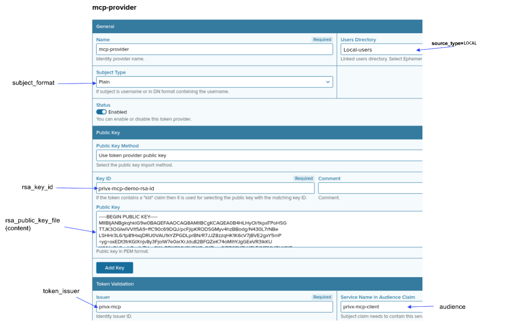

# External token provider

The external token provider sets up the user connection, the one MCP tools use to call PrivX as the caller. For each tool call, the server signs a short-lived JWT for the caller's PrivX username and exchanges it for a PrivX access token. PrivX accepts that JWT only after the server's public key is registered as an external token provider.

The provider is not used for looking up users, roles, and permissions. That goes through a separate PrivX API client configured with the `[privx_auth].api_*` settings. See [PrivX configuration](privx.md) for both connections.

## Related documents

- [PrivX configuration](privx.md)
- [MCP server configuration](SERVER.md)
- [Configure the server](../../guide/03-configure.md)
- [Configure machine-to-machine access](../../guide/04-m2m/04-m2m.md)

## Register the provider

1. Generate a key pair as described in [PrivX configuration](privx.md#1-generate-an-rsa-key-pair). Save the files on the host where the MCP server runs, in a directory the server process can read. Point `[privx_auth].rsa_key_file` at the private key.
2. In the PrivX UI, open **Administration → Deployment → External Token Authentication** and click **Add provider**.
3. Set **Name** to any label and leave **Status** enabled. Set **Public Key Method** to **Use token provider public key** and paste the public key.
4. Fill in the remaining provider fields. The table names the configuration parameter for each field.

The screenshot labels each provider field with its matching configuration parameter.

| Field                          | Description                                                                                                                                                                                                                                      | Config param name                  |
| ------------------------------ | ------------------------------------------------------------------------------------------------------------------------------------------------------------------------------------------------------------------------------------------------ | ---------------------------------- |
| Subject Type                   | Format of the subject (`sub`) claim. `plain` sends the username. `dn` sends `CN=<username>`. Normally `plain`.                                                                                                                                   | `[privx_auth].subject_format`      |
| Key ID                         | JWT key ID (`kid` header). PrivX uses it to select the public key that verifies the signature.                                                                                                                                                   | `[privx_auth].rsa_key_id`          |
| Public Key                     | PEM public key pasted into the provider. The configuration parameter is an optional path to that same file. When set, the server checks at startup that it matches `rsa_key_file`. The check is local and does not read the key stored in PrivX. | `[privx_auth].rsa_public_key_file` |
| Issuer                         | JWT issuer (`iss`). Identifies the MCP server as the token issuer. Defaults to `privx-mcp` when the configuration parameter is unset.                                                                                                            | `[privx_auth].token_issuer`        |
| Service Name in Audience Claim | JWT audience (`aud`). Identifies PrivX as the intended audience.                                                                                                                                                                                 | `[privx_auth].audience`            |
| Users Directory                | Directory the user must belong to. Set the configuration parameter to that directory's type, for example `LOCAL` for local users, `MICROSOFTGRAPH` for Entra ID users, or `AD` for Active Directory users.                                       | `[permissions].source_type`        |
